# IoT-MANUAL
MANUAL FOR BROKBUDDY
# BrokBuddy – Smart Dog Food Monitoring System*

An ESP8266 prototype that turns a simulated food shortage into an LED warning and a Telegram message.

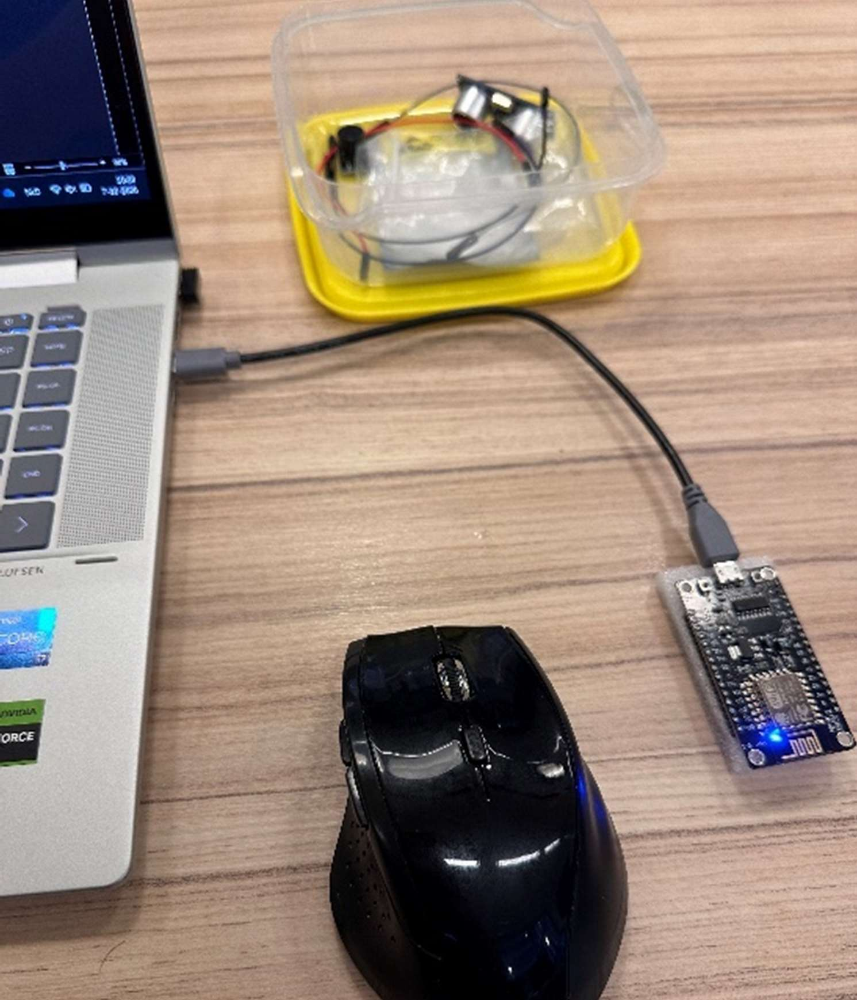

*My original USB-connected prototype.*

I built BrokBuddy to explore how a dog owner could receive a warning before the food supply runs out. The full concept uses a weight sensor; this prototype uses a **food level simulated in Arduino code**. No weight sensor is connected, and the board does not dispense food.

The project grew from a blinking LED into Wi-Fi communication, Telegram commands, and automatic alerts. This README follows that development, including the attempts that did not work.

`Simulated food level → ESP8266 → Wi-Fi → Telegram notification + built-in LED`

**Contents:** [What You Need](#what-you-need) · [How I Built It](#how-i-built-it) · [Challenges & Fixes](#challenges--fixes) · [Final Result & Lessons Learned](#final-result--lessons-learned)

## What You Need

| Item | Purpose |
| --- | --- |
| NodeMCU ESP8266 | Runs the prototype and connects to Wi-Fi |
| Built-in LED | Provides the physical warning; no external LED needed |
| USB cable and computer | Power, programming, and Serial Monitor |
| Arduino IDE with ESP8266 board support | Select **NodeMCU 1.0 (ESP-12E Module)** and upload sketches |
| Wi-Fi network or mobile hotspot | Connects the board to the internet |
| Telegram account and BotFather-created bot | Receives commands and sends warnings |
| ESP8266WiFi, WiFiClientSecure, UniversalTelegramBot | Libraries used by the Wi-Fi/Telegram sketch |

Keep network credentials and the bot token private. Screenshots included here are extracted from the manual; identifying values are redacted where needed.

## How I Built It

### 1. Connect the board and test Blink

I connected the NodeMCU by USB, saved a sketch as `BrokBuddy_Prototype`, and selected the board and its COM port. I then uploaded **File → Examples → 01.Basics → Blink**. The blinking LED confirmed that the board could receive and run code.

<details>
<summary>Setup screenshots: board, port, and upload</summary>

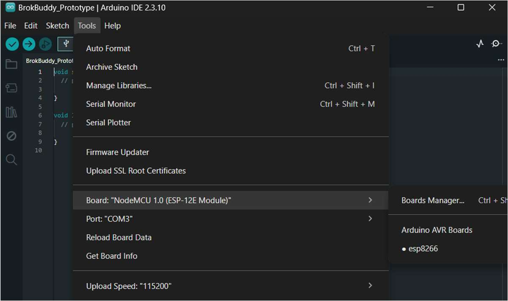
*Selecting the NodeMCU board.*

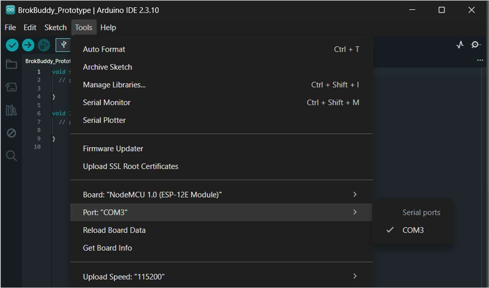
*Selecting the connected board's port.*

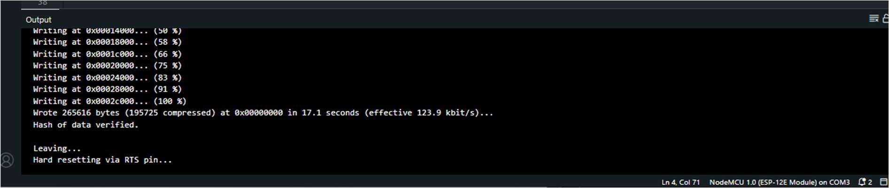
*Upload output from the first hardware test.*

</details>

### 2. Make the Serial Monitor useful

I added a startup message with `Serial.begin(9600)` and `Serial.println("BrokBuddy started")`. The manual documents an empty monitor and unreadable output: the monitor must match the sketch's baud rate. Pressing **RST** restarts the program so the one-time startup message appears again. Startup characters can still precede the readable message.

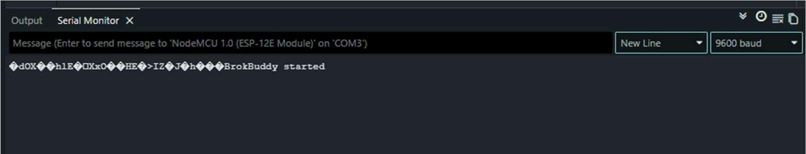
*The readable startup message after resetting the board.*

<details>
<summary>Serial troubleshooting: empty output, baud rate, and reset</summary>

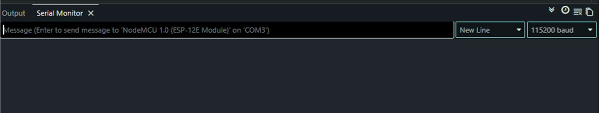
*An empty monitor before troubleshooting.*

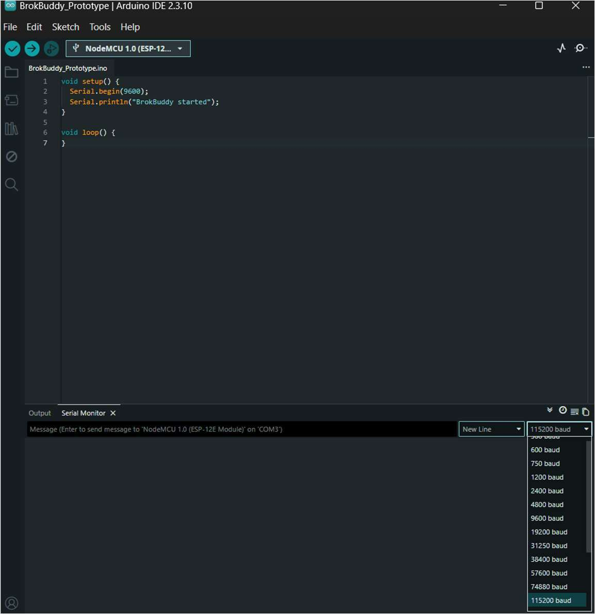
*Checking the monitor's baud rate against the sketch.*

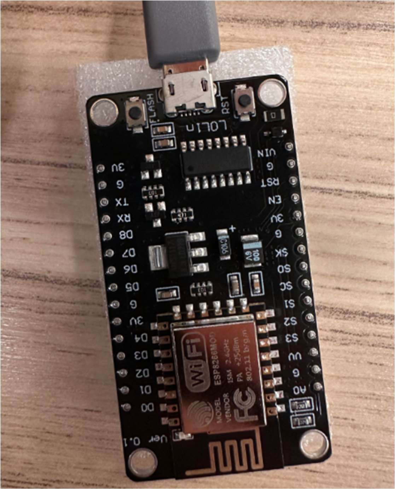

*The board used for the reset test.*

</details>

### 3. Connect to Wi-Fi

I added the network settings to the Wi-Fi/Telegram example used in the manual. After uploading, I checked the Serial Monitor for a successful connection. Unreadable connection output required the same baud-rate check as before. The source shows a successful hotspot connection; it does not establish a separate network failure with a confirmed cause.

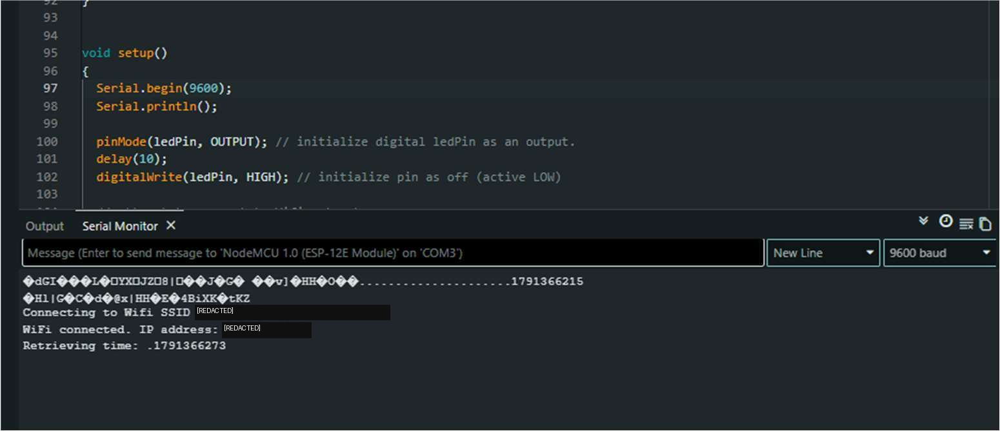
*The board connects successfully to Wi-Fi.*

<details>
<summary>Configuration screenshot</summary>

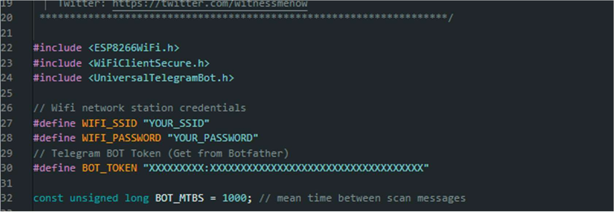
*The configuration structure, using placeholder credentials.*

</details>

### 4. Create the bot and control the LED

In Telegram, I used BotFather's `/newbot` command to create BrokBuddy, then opened the bot and sent an initial message. After configuring the token, I tested `/start`, `/ledon`, `/ledoff`, and `/status`. At this stage, `/status` reported the LED state.

**Checkpoint:** Telegram commands controlled a physical output on the ESP8266.

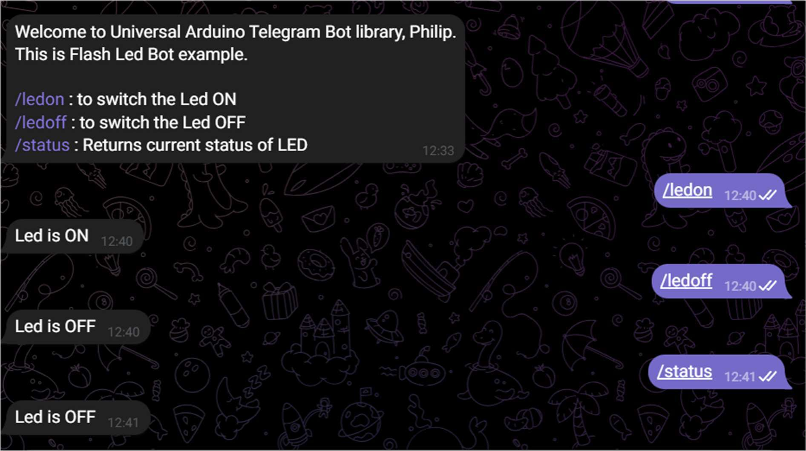
*The first working Telegram controls.*

<details>
<summary>Bot setup and first message</summary>

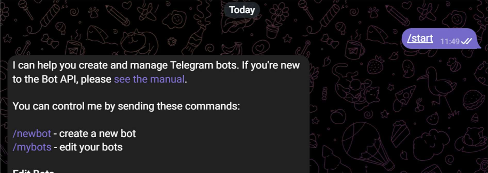
*Starting bot creation with BotFather.*

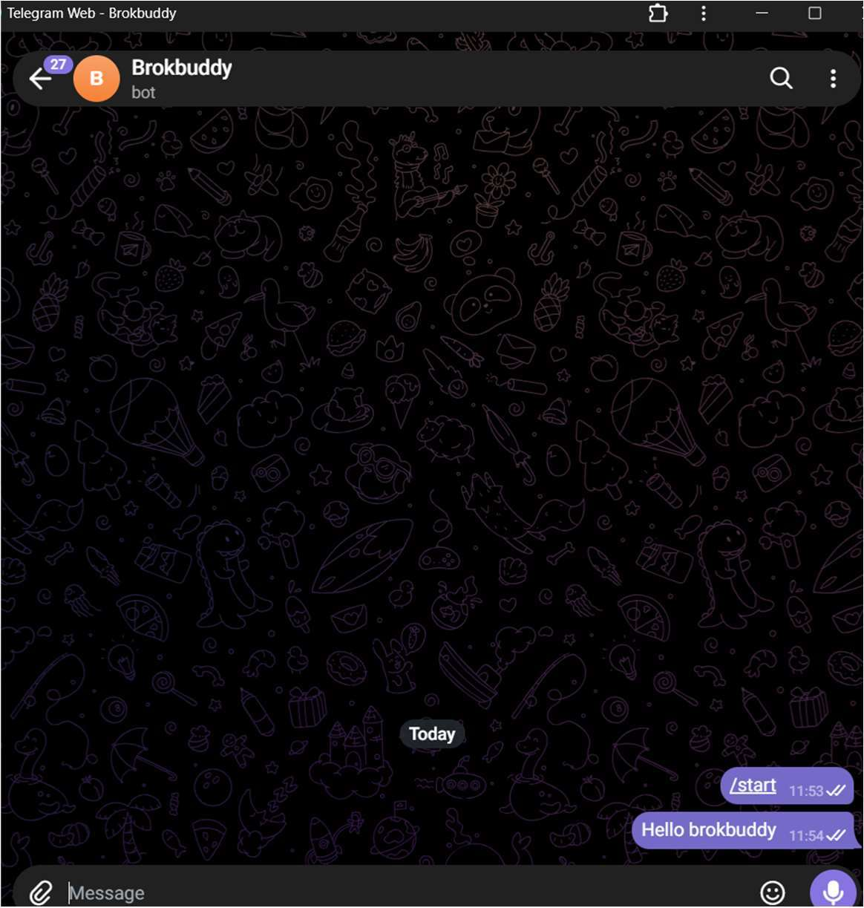
*Opening the conversation before testing replies.*

</details>

### 5. Simulate food and detect a shortage

I introduced a global `foodLevel`, initially `80`, and changed it to `15` to test a shortage below `20`. The manual explains why placing it inside `setup()` would limit its scope; it belongs with the global variables so other functions can use it.

The first detection used `while`, which trapped execution while the level remained low. Replacing it with `if` allowed the program to continue, but warnings still repeated. Adding `lowFoodWarningSent` gave the program memory of the warning. The troubleshooting sequence appears below.

<details>
<summary>Food-level variable and warning flag</summary>

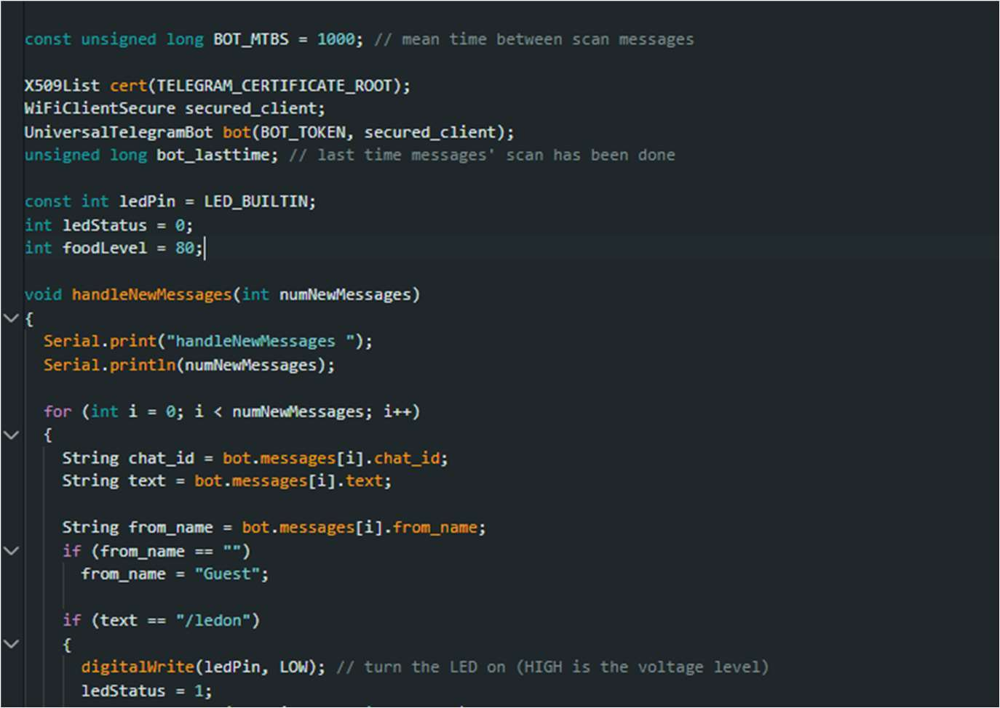
*Keeping the simulated level accessible throughout the program.*

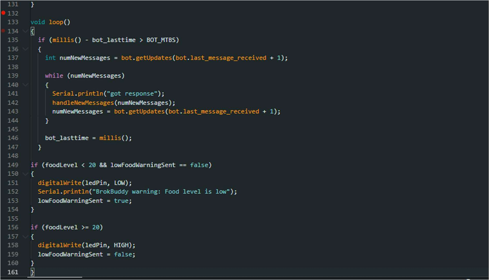
*The earlier below-20-percent warning and reset logic.*

</details>

### 6. Get the automatic Telegram warning working

Adding `bot.sendMessage()` exposed two separate problems: malformed Chat ID syntax, then a message that failed despite successful compilation. Checking the send result made the failure visible. The working change stored `ownerChatId` from an incoming message and used that destination for the alert.

After uploading, I sent `test` to the bot. With the simulated level below the threshold, the automatic warning arrived.

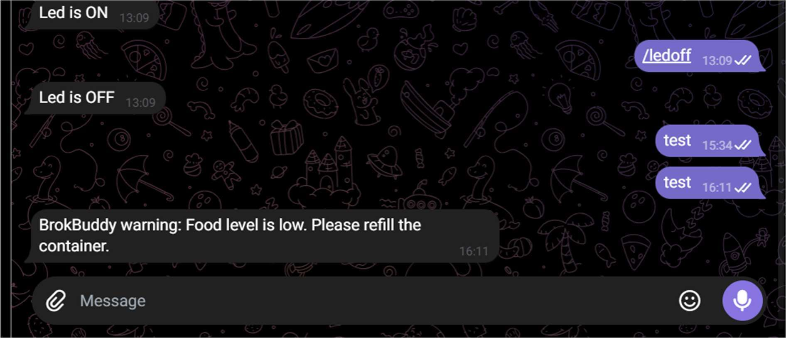
*The automatic warning finally reaches Telegram.*

<details>
<summary>Essential message-handling and send logic</summary>

These excerpts belong inside the existing sketch; they are not standalone firmware.

```cpp
// Global variable:
String ownerChatId = "";

// Inside the incoming-message handler:
String chat_id = bot.messages[i].chat_id;
ownerChatId = chat_id;
```

```cpp
// Earlier working low-food notification block:
if (foodLevel < 20 && !lowFoodWarningSent && ownerChatId != "") {
  digitalWrite(ledPin, LOW);
  bool messageSent = bot.sendMessage(
    ownerChatId,
    "BrokBuddy warning: Food level is low. Please refill the container.",
    ""
  );
  if (messageSent) {
    Serial.println("Telegram warning sent successfully");
    lowFoodWarningSent = true;
  } else {
    Serial.println("Telegram warning failed");
  }
}
```


*Capturing the destination from an incoming message.*

</details>

### 7. Extend status and automate the simulation

I updated `/status` to report the food percentage and **LOW** or **OK**, then returned the starting level to `80`. A `millis()` timer decreased it by ten percentage points every ten seconds. The final Serial Monitor screenshot shows the level falling from 70% to 20%, followed by the warning; the board photo shows the LED lit.

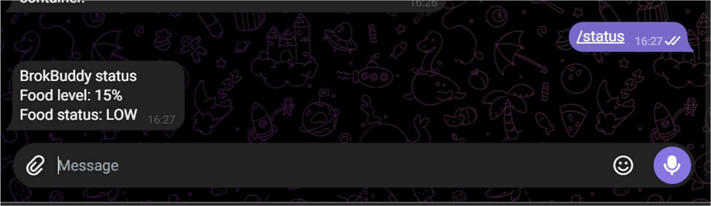
*The expanded status command.*

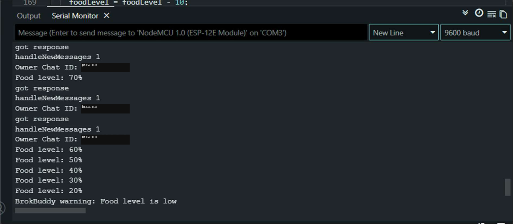
*The final timed simulation, with chat identifiers redacted.*

<details>
<summary>Timer configuration from the final build</summary>

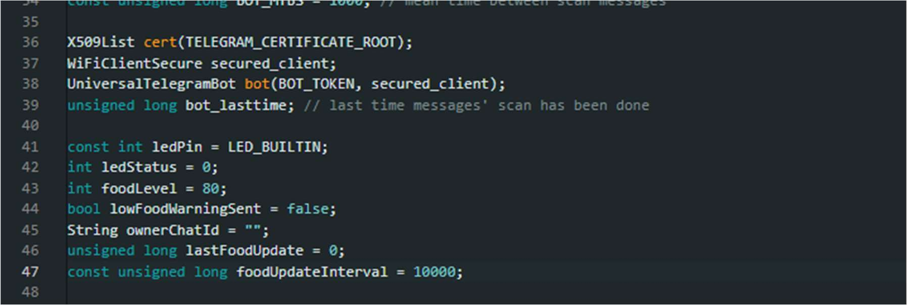
*A ten-second update interval for the simulated level.*

</details>

## Challenges & Fixes

The clearest lesson was that a first fix did not always solve the whole problem.

### A warning that would not stop

**Problem:** At `15`, the `while (foodLevel < 20)` loop repeatedly printed warnings and Telegram stopped responding. The value never changed inside that loop.

**Attempt:** Replacing `while` with `if` removed the blocking loop, but Arduino's `loop()` kept evaluating the same true condition.

**Fix and lesson:** `lowFoodWarningSent` suppressed repeated activation. I learned to distinguish a blocking loop from a condition that repeatedly becomes eligible.

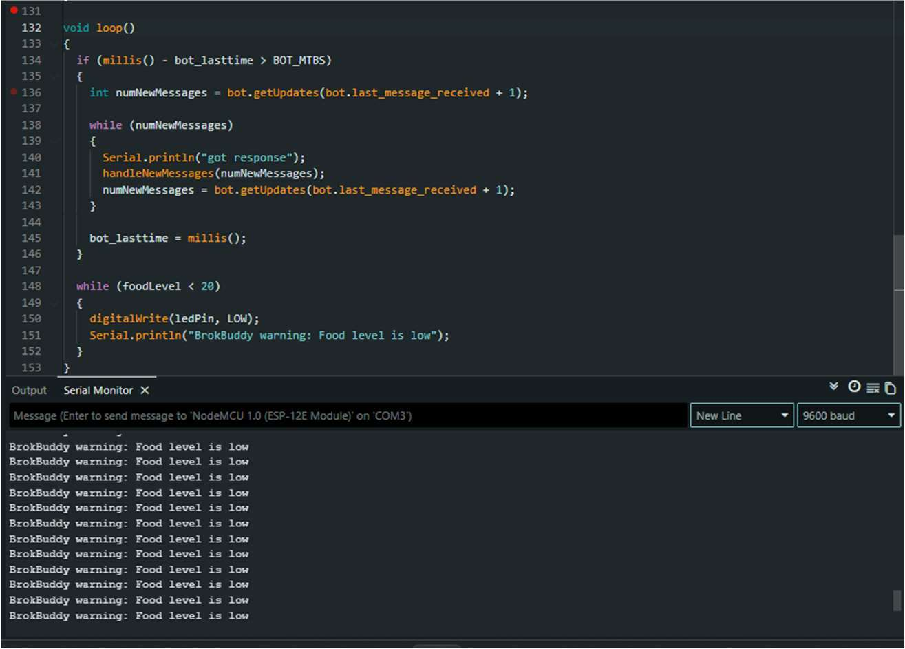
*The blocking attempt.*

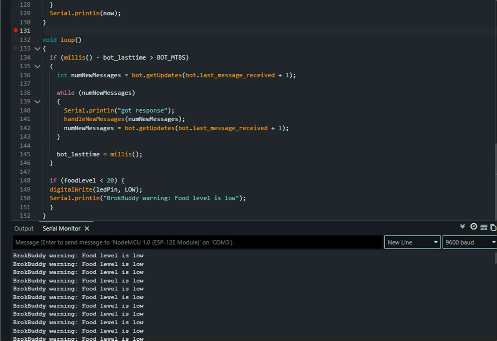
*Changing to if was only a partial fix.*

### A Chat ID that would not compile

**Problem:** The Chat ID definition included copied `id` syntax and incorrect quotation marks, producing `missing terminating " character`.

**Fix and result:** Keeping only the ID as a quoted string allowed compilation and upload. I learned that valid configuration syntax and successful message delivery are separate checks.

```cpp
#define CHAT_ID "YOUR_CHAT_ID"
```

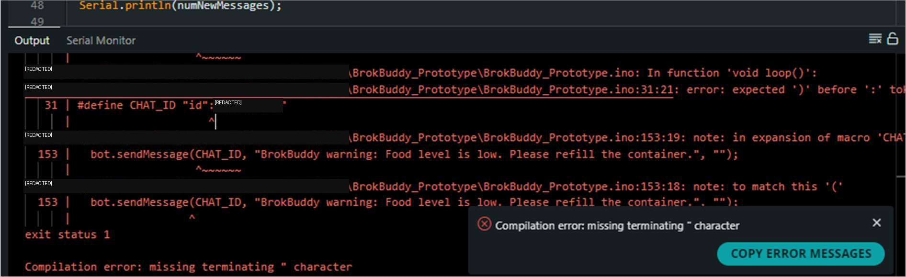
*The original compiler error, with identifying values redacted.*

### Detection worked, but delivery failed

**Problem:** The local warning appeared, but Telegram received nothing. Checking `bot.sendMessage()` revealed `Telegram warning failed`.

**Fix and result:** Capturing `ownerChatId` from an incoming message produced the successful alert shown above. The PDF does not prove the exact underlying cause of the earlier delivery failure. I learned to check the send result and set the warning flag only after success.

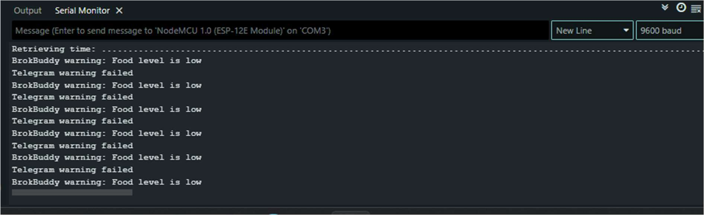
*Evidence that local detection did not guarantee delivery.*

## Final Result & Lessons Learned

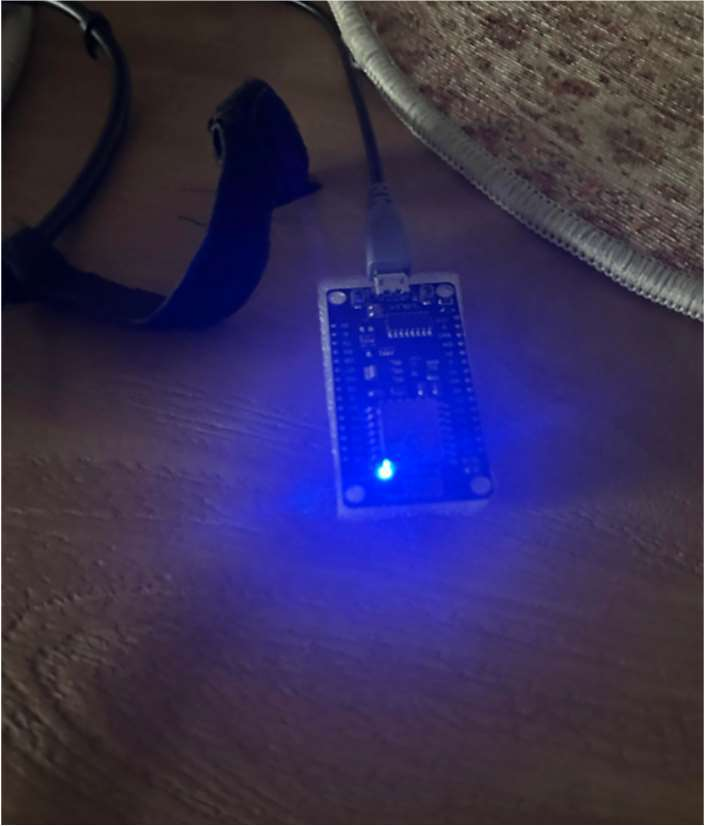

*The physical warning during the final simulation.*

The manual demonstrates Wi-Fi connectivity, Telegram LED control, an automatic low-food message, food-status replies, and a decreasing simulated level. Building these in small steps helped me separate hardware, communication, and logic problems.

**Limitations:** There is no real food measurement or automatic feeder. `ownerChatId` is held in memory and must be learned from an incoming message after restart. The excerpts are documentation, not a complete uploadable sketch.

**Source-code inconsistency:** The final version warns at `<= 20` but resets at `>= 20`, so both conditions match exactly 20%. Its `/status` check still uses `< 20`. This can reset the warning flag and report OK at the warning boundary. The earlier notification test succeeded, but the manual does not demonstrate a corrected, consistent final threshold. Aligning those conditions is a follow-up improvement, not a claimed completed fix.

*Adapted from the original 36-page BrokBuddy manual. Original screenshots and photos are retained selectively; repeated views and decorative fragments are omitted.*
